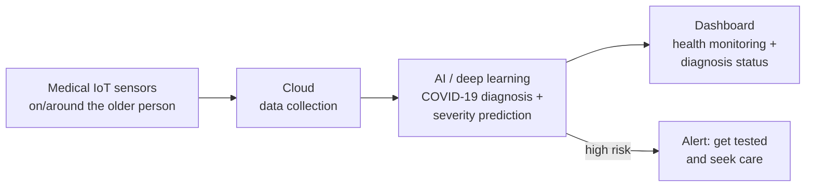

<div align="center">

# Elder Care During COVID-19

**Supporting work for our IEEE paper, [*Ambient Assisted Living for Elderly Care and Monitoring in COVID-19 Pandemic*](https://ieeexplore.ieee.org/abstract/document/9564005): a machine-learning model that predicts how severe COVID-19 is likely to be in older adults.**

[](https://ieeexplore.ieee.org/abstract/document/9564005)
[](https://doi.org/10.1109/ICOIACT53268.2021.9564005)


[](LICENSE)

</div>

---

## The paper

> **Ambient Assisted Living for Elderly Care and Monitoring in COVID-19 Pandemic**
> Shovon Bhowmick, **Tarek Ferdous**, Raihan Momtaz, Md. Golam Rabiul Alam
> *2021 4th International Conference on Information and Communications Technology (ICOIACT)*, pp. 98–103, IEEE, 2021
> [IEEE Xplore](https://ieeexplore.ieee.org/abstract/document/9564005) · [DOI: 10.1109/ICOIACT53268.2021.9564005](https://doi.org/10.1109/ICOIACT53268.2021.9564005)

Older people are especially vulnerable to COVID-19 because their immune systems are weaker, and many also live with physical or cognitive impairments. With new variants driving wave after wave, the paper proposes an **IoT-based ambient assisted living system with AI and deep learning** to help diagnose COVID-19 in older people. Medical IoT sensors collect health data and send it to the cloud. There the system processes it to monitor each person's health, and caregivers see the COVID-19 diagnosis status on a dedicated dashboard. The aim is a system that is also ready for future pandemics.



## This repository

This repo was set up for one supporting task in the framework: a model that **predicts COVID-19 severity in older people**, so they or their caregivers can be alerted to get tested early and take steps toward treatment.

> **The notebook isn't published here.** `elder_care_during_covid-19_main.ipynb` is a placeholder. This early version wasn't used in the final paper, and the newer notebook behind the published work wasn't released.

## Citation

```bibtex
@inproceedings{bhowmick2021ambient,
  title     = {Ambient Assisted Living for Elderly Care and Monitoring in COVID-19 Pandemic},
  author    = {Bhowmick, Shovon and Ferdous, Tarek and Momtaz, Raihan and Rabiul Alam, Md. Golam},
  booktitle = {2021 4th International Conference on Information and Communications Technology (ICOIACT)},
  pages     = {98--103},
  year      = {2021},
  publisher = {IEEE},
  doi       = {10.1109/ICOIACT53268.2021.9564005}
}
```

## License

[MIT](LICENSE) © 2026 tarekFerdous, for the code in this repository. The paper itself is © IEEE.
