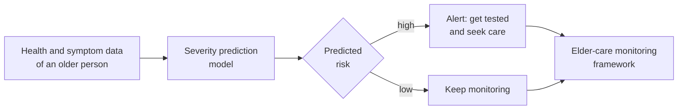

# Elder Care During COVID-19

**A machine-learning model to predict how severe COVID-19 is likely to be in older adults, built as a supporting task for my thesis.**

---

## About

Older people were among the most vulnerable to COVID-19, and early action made a big difference. My thesis proposed a **monitoring framework for elder care during the pandemic**. One of its features was a model that predicts how severe an infection is likely to be, so an older person or their caregiver can be **alerted to get tested early** and take steps toward treatment.

This repository was set up for that severity-prediction task.

## Status

> **The notebook isn't published here.**
> `elder_care_during_covid-19_main.ipynb` is a placeholder. The notebook used in the final thesis paper was a newer version that couldn't be shared at the time, because the paper was still awaiting publication.

## License

[MIT](LICENSE) © 2026 tarekFerdous
